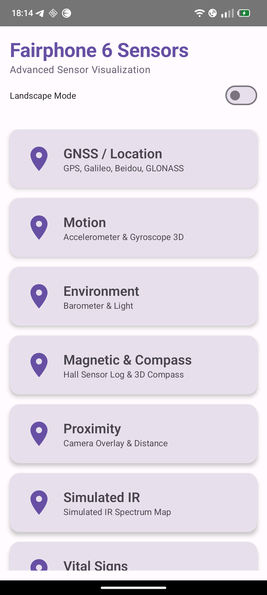
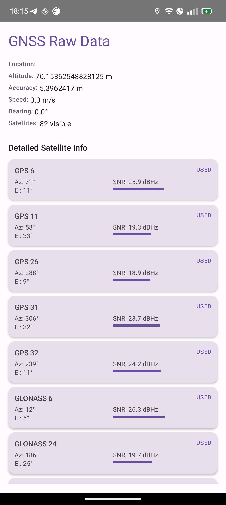
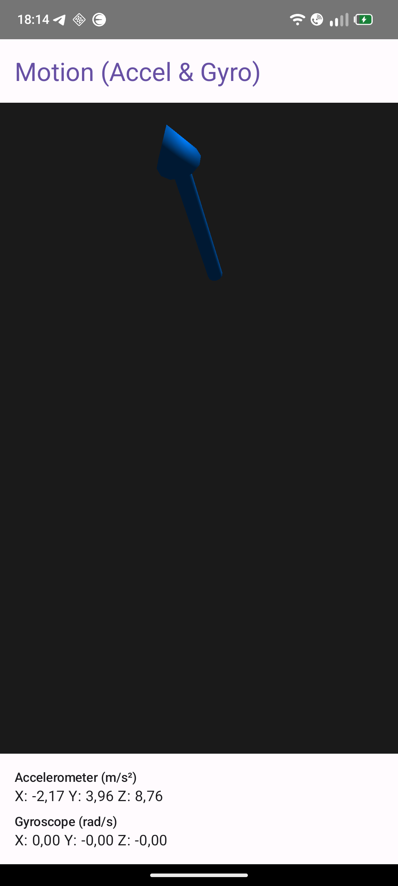
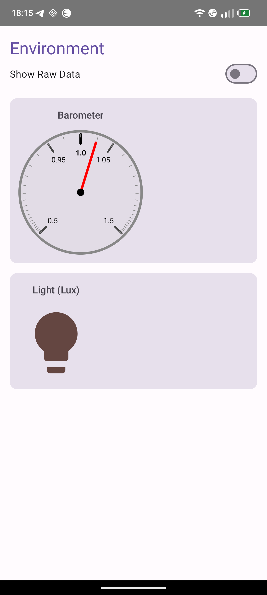
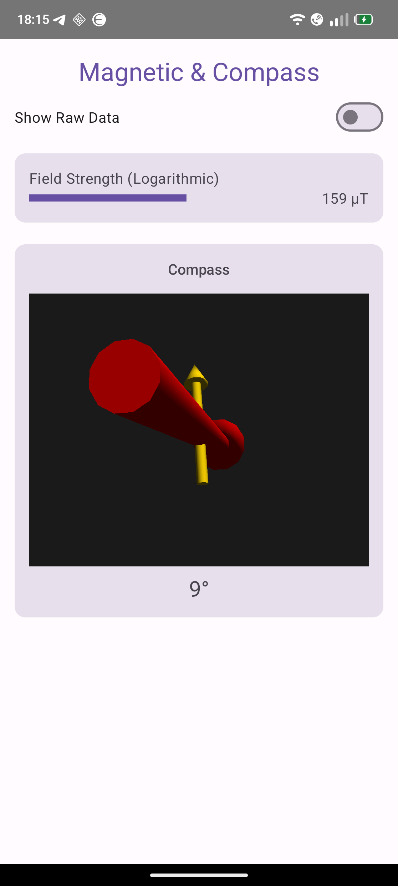

# fp6sense

**An experiment in hardware sensing: what can a smartphone measure if you use its sensors beyond their intended purpose?**

A modern phone carries a dozen sensors — accelerometer, gyroscope, magnetometer, barometer, light, proximity, a multi-constellation GNSS receiver, a camera that can deliver RAW sensor data. Most apps show almost none of it. fp6sense is an Android app that puts these sensors on screen and then pushes a few of them into roles they were never designed for: a heartbeat monitor, a contact microphone, a "thermal" camera.

Developed and tested on a Fairphone 6. Not affiliated with Fairphone.

<p align="center">
  
</p>

## The experiments

These are prototypes, not instruments. Each comes with an honest status.

### Heartbeat from the accelerometer (seismocardiography)

Lie down, place the phone on your sternum: each heartbeat moves the chest wall by a tiny amount. The app reads the Z axis of `LINEAR_ACCELERATION`, separates a slow breathing component (low-pass IIR) from the faster cardiac component (high-pass + smoothing), and estimates heart rate and respiration rate from peak intervals. Signals are shown as 2D graphs and as a rotatable 3D plot.

*Status:* works in calm conditions; simple filters and threshold-based peak detection, sensitive to movement, not validated against a reference.

> **Not a medical device.** Do not use it for any health or diagnostic decision.

### Accelerometer + gyroscope as a "vibration microphone"

Tap or scratch the phone (or the table it lies on) and record the result as sound. A dedicated thread samples `LINEAR_ACCELERATION` (Z axis → left channel) and `GYROSCOPE` (X axis → right channel), upsamples to 44.1 kHz with sample-and-hold plus slew smoothing, applies logarithmic (μ-law-style) companding and writes a 16-bit stereo WAV file.

*Status:* records and plays back; the real bandwidth is limited by the motion sensors' sampling rate (a few hundred Hz), so expect thumps and rumble, not speech.

### "Infrared" from Camera2 RAW

Phone cameras have an IR-cut filter, so this is **not** real thermal imaging. It is an experiment in getting at raw sensor data: frames are captured as `RAW_SENSOR` (or `RAW10`) via Camera2, uploaded to the GPU and decoded from the Bayer pattern in an OpenGL ES 3.0 fragment shader, which maps intensity to a false-colour heat palette.

*Status:* runs on device; the colour mapping still needs tuning — in typical indoor scenes the output saturates.

### The classic dashboards

| Feature | Sensors | What you see |
|---|---|---|
| GNSS / Location | `LocationManager`, `GnssStatus` | Position, accuracy, every visible satellite per constellation (GPS, Galileo, BeiDou, GLONASS) with azimuth, elevation, SNR and "used in fix" |
| Motion | Accelerometer + gyroscope | Live 3D orientation, raw values |
| Environment | Barometer + ambient light | Pressure gauge, light level |
| Magnetic & Compass | Magnetometer | Field strength (log scale), 3D compass |
| Proximity | Proximity + ambient light | Camera overlay controlled by distance and lux |

<p align="center">
  
  
  
  
</p>

## Architecture

Kotlin, Jetpack Compose, Material 3. Single activity, `NavHost` with one route per feature. Clean Architecture per feature (`domain/` → `data/` → `presentation/`), manual dependency injection, no Hilt/Dagger.

Every sensor feature (except infrared) follows the same pattern:

1. `domain/repository/` — interface exposing `getSensorData(): Flow<T>` and `isSensorAvailable()`
2. `data/repository/` — a `callbackFlow { … awaitClose { unregister } }` wrapping `SensorManager` / `LocationManager`
3. `presentation/` — a ViewModel collects the flow into a `StateFlow`; the Compose screen renders it

The infrared feature drives Camera2 and an OpenGL ES 3.0 renderer directly from the screen; the vibration feature runs its own recording thread.

## Build

Requirements: JDK 21, Android SDK (compile/target SDK 34, min SDK 26).

```bash
./gradlew assembleDebug   # build debug APK
./gradlew installDebug    # build and install on a connected device
./gradlew lint
```

Permissions requested at runtime: location (GNSS), camera (proximity overlay, infrared). `HIGH_SAMPLING_RATE_SENSORS` is declared for the motion-based experiments.

Sensor availability and RAW camera support vary between devices; on hardware other than the Fairphone 6, some experiments may not work.
